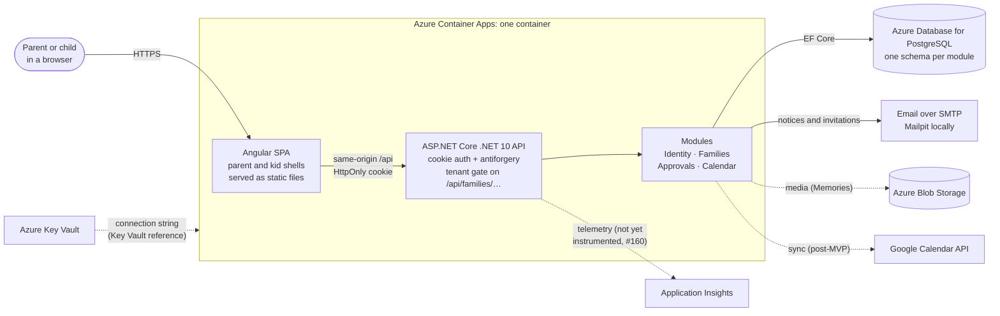
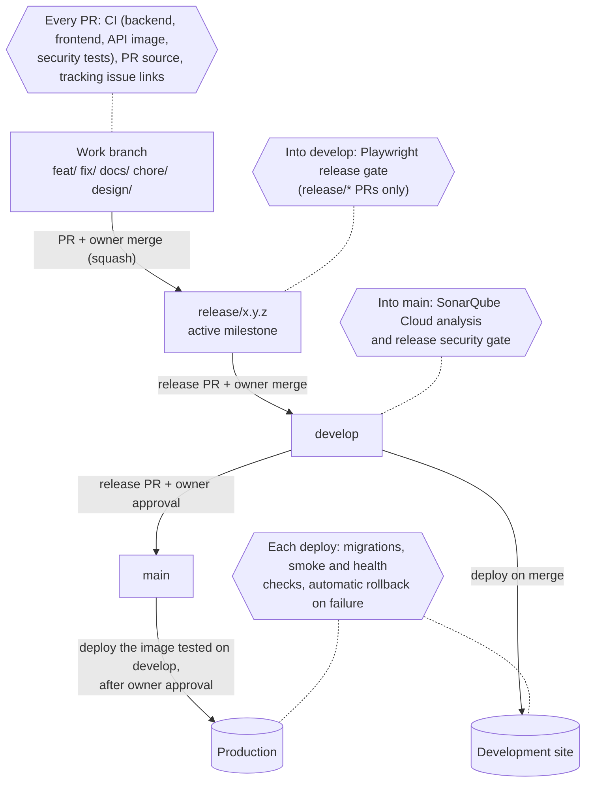

# Architecture at a glance

Two diagrams for finding your way around: how a request flows through the running application, and how a change
gets from a work branch to production. The detailed design (modules, approvals, security model, decisions) lives
in the [solution architecture](architecture/solution-architecture.md), which stays the canonical technical
reference. The [database ERD](architecture/database-erd.md) covers the data model.

Solid lines are wired up today. Dashed lines are planned in the architecture but not used by the code yet.

## Runtime: from the browser to the database

- **One origin.** The API container serves the Angular build, so cookies stay HttpOnly and `SameSite=Strict`
  without CORS ([ADR-0004](adr/0004-cookie-authentication.md)).
- **Authorization happens on the server.** Every family route resolves the caller's membership before a module
  runs; hiding something in the UI is never the boundary ([ADR-0002](adr/0002-tenant-isolation.md)).
- **Secrets** reach the container app as Key Vault references through its managed identity
  ([Azure runbook](runbooks/azure-environments.md)).
- **Telemetry:** the Application Insights resource exists, but request and dependency telemetry is not yet
  established ([verification, #160](runbooks/application-insights-verification-2026-10-25.md)).

## Delivery: from a work branch to production

| Gate | Runs on | Workflow |
|---|---|---|
| CI: backend build, format and tests; frontend lint, Vitest and build; API image smoke test; release security tests | Every PR, and pushes to `main`, `develop` and `release/**` | [`ci.yml`](../.github/workflows/ci.yml) |
| PR source: which branch may merge into which | Every PR | [`pr-branch-policy.yml`](../.github/workflows/pr-branch-policy.yml) |
| Tracking issue links | Every PR | [`pr-issue-links.yml`](../.github/workflows/pr-issue-links.yml) |
| Playwright release candidate | PRs from `release/*` into `develop`, not drafts | [`playwright-release.yml`](../.github/workflows/playwright-release.yml) ([runbook](runbooks/playwright-release-gate.md)) |
| SonarQube Cloud and release security gate | PRs into `main`, and pushes to `main` | [`sonar.yml`](../.github/workflows/sonar.yml) ([runbook](runbooks/sonar-release-gate.md)) |
| Deploy, migrate, smoke test, roll back | Pushes to `develop` and `main`; manual rollback | [`deploy.yml`](../.github/workflows/deploy.yml) |

Branch rules, release windows and approvals are described in the [development workflow](development-workflow.md).

## Keeping this page current

An architecture change and its documentation ship in the **same PR**. That includes a new module, service,
external integration, data store, auth or tenant-isolation change, workflow gate or deployment step. Update the
diagrams on this page, the [solution architecture](architecture/solution-architecture.md) and, for a decision, an
[ADR](adr/). Check that the Mermaid blocks still render in GitHub's preview before asking for review.
