# Database Entity Relationship Design

> Status: **Approved** (2026-10-16). PostgreSQL 17, EF Core 10 (Npgsql). One database, one schema per module.

## Conventions

- **PKs:** `uuid` generated as UUID v7 in the application.
- **Tenancy:** every family-owned table has a non-null `family_id`, **join tables included**. This keeps future Row-Level Security policies uniform and makes `(family_id, …)` composite indexes the default.
- **Timestamps:** `timestamptz` in UTC. Calendar events also store the IANA `time_zone` so recurring and DST-crossing events display correctly.
- **Concurrency:** PostgreSQL `xmin` mapped as a row version on aggregates that can be edited concurrently (ChangeRequest, CalendarEvent, Memory).
- **Enums:** stored as `text`. That's readable, migration-friendly and keeps the DB portable for analytics.
- **Soft delete:** only where the domain needs it (Memory). Elsewhere the status column records the lifecycle.
- **Actors:** family-scoped tables reference `family_membership_id`, not `user_id`, for "created by" and "decided by". That ties actions to a role in a specific family.
- **Cross-module references** (e.g. `calendar.event_child.child_profile_id → families.child_profile`) are real FKs inside the same database. That's acceptable in a modular monolith; the module boundary is enforced in code, not by removing referential integrity.

## ER diagram (MVP + planned)

```mermaid
erDiagram
  %% ---------- identity ----------
  USER {
    uuid id PK
    text email "nullable for child accounts"
    text user_name
    text display_name
    text user_type "Adult | Child"
    bool is_platform_admin
    timestamptz created_at
  }

  %% ---------- families ----------
  FAMILY {
    uuid id PK
    text name
    text time_zone
    timestamptz created_at
  }
  FAMILY_MEMBERSHIP {
    uuid id PK
    uuid family_id FK
    uuid user_id FK
    text role "Parent | Child"
    text status "Active | Left | Suspended"
    uuid child_profile_id FK "set when role = Child"
    timestamptz joined_at
  }
  INVITATION {
    uuid id PK
    uuid family_id FK
    text role "Parent | Child"
    text email "parent invites"
    uuid child_profile_id FK "child invites"
    bytea token_hash "SHA-256; raw token only in email/link"
    text status "Pending | Accepted | Revoked | Expired"
    uuid invited_by_membership_id FK
    timestamptz expires_at
  }
  CHILD_PROFILE {
    uuid id PK
    uuid family_id FK
    text display_name
    smallint birth_year "optional"
    smallint birth_month "optional"
    text avatar_blob_key
    uuid created_by_membership_id FK
  }
  PARENT_CHILD_RELATIONSHIP {
    uuid family_id FK
    uuid parent_membership_id PK, FK
    uuid child_profile_id PK, FK
  }
  CATEGORY_APPROVAL_POLICY {
    uuid family_id PK, FK
    text category PK
    bool requires_approval
  }

  %% ---------- approvals ----------
  CHANGE_REQUEST {
    uuid id PK
    uuid family_id FK
    text type "CalendarCreate | CalendarModify | CalendarCancel | MemoryDelete | ChildAccessGrant"
    text target_type
    uuid target_id
    int target_version "optimistic base, Stale detection"
    jsonb payload "proposed change / diff"
    text reason
    text status "Pending | Approved | Rejected | Withdrawn | Expired | Stale"
    uuid requested_by_membership_id FK
    timestamptz created_at
    timestamptz expires_at
    timestamptz resolved_at
  }
  APPROVAL_DECISION {
    uuid id PK
    uuid family_id FK
    uuid change_request_id FK
    uuid decider_membership_id FK
    text decision "Approve | Reject"
    text comment
    timestamptz decided_at
  }

  %% ---------- calendar ----------
  CALENDAR_EVENT {
    uuid id PK
    uuid family_id FK
    text title
    text description
    text location
    text category "ParentingTime | School | Medical | Dental | Activity | Holiday | Birthday | Family"
    timestamptz starts_at
    timestamptz ends_at
    bool all_day
    text time_zone
    text recurrence_rule "RFC 5545 RRULE, post-MVP"
    text status "PendingApproval | Confirmed | Rejected | Cancelled"
    uuid custodial_membership_id FK "ParentingTime only"
    int version
    uuid created_by_membership_id FK
    timestamptz created_at
  }
  EVENT_CHILD {
    uuid family_id FK
    uuid event_id PK, FK
    uuid child_profile_id PK, FK
  }
  EVENT_REMINDER {
    uuid id PK
    uuid family_id FK
    uuid event_id FK
    uuid membership_id FK "reminders are personal"
    int minutes_before
  }

  %% ---------- memories ----------
  MEMORY {
    uuid id PK
    uuid family_id FK
    uuid child_profile_id FK "nullable: family-wide memory"
    text kind "Photo | Artwork | DiaryText | DiaryAudio | Video"
    text title
    text description
    bytea body_encrypted "diary text"
    text visibility "Family | ParentsOnly | Private"
    text state "Active | Restricted | SoftDeleted"
    uuid uploaded_by_membership_id FK
    timestamptz created_at
    timestamptz deleted_at
    timestamptz purge_after
  }
  MEMORY_ATTACHMENT {
    uuid id PK
    uuid family_id FK
    uuid memory_id FK
    text blob_key
    text thumbnail_blob_key
    text content_type
    bigint size_bytes
    bytea sha256
    int width
    int height
    int duration_seconds
    bool metadata_stripped
  }
  MEMORY_RESTRICTION {
    uuid id PK
    uuid family_id FK
    uuid memory_id FK
    uuid restricted_by_user_id FK
    text reason_code "Safety | Privacy | Legal | Other"
    text note
    timestamptz restricted_at
    timestamptz lifted_at
  }

  %% ---------- messaging (post-MVP) ----------
  CONVERSATION {
    uuid id PK
    uuid family_id FK
    timestamptz created_at
  }
  CONVERSATION_PARTICIPANT {
    uuid family_id FK
    uuid conversation_id PK, FK
    uuid membership_id PK, FK
    uuid last_read_message_id
  }
  MESSAGE {
    uuid id PK
    uuid family_id FK
    uuid conversation_id FK
    uuid sender_membership_id FK
    text body
    timestamptz sent_at
  }
  MESSAGE_ATTACHMENT {
    uuid id PK
    uuid family_id FK
    uuid message_id FK
    text blob_key
    text content_type
    bigint size_bytes
  }

  %% ---------- notifications / audit / integrations ----------
  NOTIFICATION {
    uuid id PK
    uuid family_id FK
    uuid recipient_user_id FK
    text type
    jsonb data
    timestamptz created_at
    timestamptz read_at
  }
  AUDIT_LOG {
    bigint id PK "append-only"
    uuid family_id "nullable for platform events"
    uuid actor_user_id
    text actor_type "Parent | Child | PlatformAdmin | System"
    text action
    text resource_type
    uuid resource_id
    jsonb data
    text correlation_id
    timestamptz occurred_at
  }
  EXTERNAL_CALENDAR_CONNECTION {
    uuid id PK
    uuid family_id FK
    uuid user_id FK
    text provider "Google"
    bytea refresh_token_encrypted
    text scopes
    text target_calendar_id
    text status "Active | Revoked | Error"
    timestamptz connected_at
  }
  EXTERNAL_EVENT_LINK {
    uuid connection_id PK, FK
    uuid calendar_event_id PK, FK
    uuid family_id FK
    text external_event_id
    int synced_version
    text etag
  }
  OUTBOX_MESSAGE {
    uuid id PK
    text type
    jsonb payload
    timestamptz occurred_at
    timestamptz processed_at
    int attempts
    text last_error
  }

  USER ||--o{ FAMILY_MEMBERSHIP : "has"
  FAMILY ||--o{ FAMILY_MEMBERSHIP : "has"
  FAMILY ||--o{ INVITATION : "issues"
  FAMILY ||--o{ CHILD_PROFILE : "has"
  CHILD_PROFILE ||--o| FAMILY_MEMBERSHIP : "login (optional)"
  FAMILY_MEMBERSHIP ||--o{ PARENT_CHILD_RELATIONSHIP : "parent of"
  CHILD_PROFILE ||--o{ PARENT_CHILD_RELATIONSHIP : "child of"
  FAMILY ||--o{ CATEGORY_APPROVAL_POLICY : "configures"

  FAMILY ||--o{ CHANGE_REQUEST : "has"
  CHANGE_REQUEST ||--o{ APPROVAL_DECISION : "receives"
  FAMILY_MEMBERSHIP ||--o{ CHANGE_REQUEST : "requests"
  FAMILY_MEMBERSHIP ||--o{ APPROVAL_DECISION : "decides"

  FAMILY ||--o{ CALENDAR_EVENT : "has"
  CALENDAR_EVENT ||--o{ EVENT_CHILD : "involves"
  CHILD_PROFILE ||--o{ EVENT_CHILD : "attends"
  CALENDAR_EVENT ||--o{ EVENT_REMINDER : "has"

  FAMILY ||--o{ MEMORY : "has"
  CHILD_PROFILE ||--o{ MEMORY : "about"
  MEMORY ||--o{ MEMORY_ATTACHMENT : "has"
  MEMORY ||--o{ MEMORY_RESTRICTION : "restricted by"

  FAMILY ||--o{ CONVERSATION : "has"
  CONVERSATION ||--o{ CONVERSATION_PARTICIPANT : "includes"
  CONVERSATION ||--o{ MESSAGE : "contains"
  MESSAGE ||--o{ MESSAGE_ATTACHMENT : "has"

  USER ||--o{ NOTIFICATION : "receives"
  USER ||--o{ EXTERNAL_CALENDAR_CONNECTION : "authorizes"
  EXTERNAL_CALENDAR_CONNECTION ||--o{ EXTERNAL_EVENT_LINK : "tracks"
  CALENDAR_EVENT ||--o{ EXTERNAL_EVENT_LINK : "mirrored as"
```

## Mapping to the spec's entity list

| Spec entity | This design |
|---|---|
| User | `identity.user` (ASP.NET Core Identity `IdentityUser<Guid>` + extra columns) |
| Family, FamilyMembership, ChildProfile, ParentChildRelationship | Same names in `families` |
| CalendarEvent | `calendar.calendar_event` (+ `event_child`, `event_reminder`) |
| CalendarProposal / DeletionRequest | `approvals.change_request` (`type` tells them apart) |
| CalendarApproval / DeletionApproval | `approvals.approval_decision` |
| Memory, MemoryAttachment | Same names in `memories` (+ `memory_restriction` for protective actions) |
| Conversation, Message, MessageAttachment | Same names in `messaging` (+ `conversation_participant`) |
| Notification, AuditLog, ExternalCalendarConnection | Same names (+ `external_event_link` for de-duplication) |
| *(new)* Invitation, CategoryApprovalPolicy, OutboxMessage | Needed for invitations, configurable approvals and reliable side effects |

## M2 additions (ADR-0006, accepted 2026-10-17)
The new tables for profile picker sign-in, child PINs, paired child devices, and children that need both parents'
approval:
- **`device`:** a household device or a child's paired tablet.
- **`device_pairing_code`:** single-use, valid for 10 minutes, stored hashed.
- **`child_credential`:** the PIN hash, a failed-attempt counter, and the lock state.

#153 ([ADR-0007](../adr/0007-shared-devices-and-parent-pins.md), proposed) adds `devices.expires_at` (shared
devices: 30 days from setup), pause and concurrency columns on `child_credentials`, and a `parent_credentials` table
(one six-digit parent PIN per family membership, hashed, with the same pause-then-lock counters).
- **`child_profile.status`:** `PendingApproval | Active | Archived`.
- **`change_request.type`:** gains `ChildCreate`.

Full columns: [ADR-0006](../adr/0006-profiles-pins-and-child-devices.md#data-model-additions-identity-and-families-schemas).
Child sign-in no longer uses an Identity user with `user_type = Child`. That column stays for compatibility until the
migration removes it.

## Key constraints and indexes

| Table | Constraint / index | Why |
|---|---|---|
| family_membership | `UNIQUE (family_id, user_id)` | One membership per user per family |
| family_membership | `CHECK (role <> 'Child' OR child_profile_id IS NOT NULL)` | A child login must map to a profile |
| invitation | `UNIQUE (token_hash)`; partial index `WHERE status = 'Pending'` | Token lookup; expiry sweeps |
| change_request | Partial `UNIQUE (target_type, target_id) WHERE status = 'Pending'` | At most **one open request per target**, which avoids conflicting parallel proposals |
| change_request | `(family_id, status, created_at DESC)` | Approvals inbox |
| approval_decision | `UNIQUE (change_request_id, decider_membership_id)` | One vote per parent |
| calendar_event | `(family_id, starts_at)` and a `tstzrange` GiST index | Range queries; overlap detection for parenting time |
| calendar_event | Exclusion constraint on overlapping **Confirmed ParentingTime** per child *(post-MVP, needs `event_child` denormalized)* | Prevents double-booked custody |
| memory | `(family_id, child_profile_id, created_at DESC)`; partial `WHERE state = 'Active'` | Gallery queries |
| memory | `(purge_after) WHERE state = 'SoftDeleted'` | Purge worker |
| audit_log | `REVOKE UPDATE, DELETE` from the app role | Append-only by privilege, not by convention |
| notification | `(recipient_user_id, read_at NULLS FIRST, created_at DESC)` | Unread badge |

## Lifecycle notes

- **Memory deletion.** `Active` → (both parents approve `MemoryDelete`) → `SoftDeleted` with `purge_after = now() + family recovery period` (default 30 days) → the purge worker deletes the blobs and hard-deletes the rows, keeping only the `audit_log` record. Any parent can restore during the recovery period.
- **Restriction (protective).** Any parent, or the uploading child, can move `Active → Restricted` straight away. The content is hidden from children and from the family gallery but kept. Lifting a restriction needs the other parent's approval if a parent made it. Platform-level legal removals go through the admin break-glass runbook.
- **Membership exit.** A parent can *leave* (status `Left`). Their past actions stay attributable. One parent can never remove the other.
