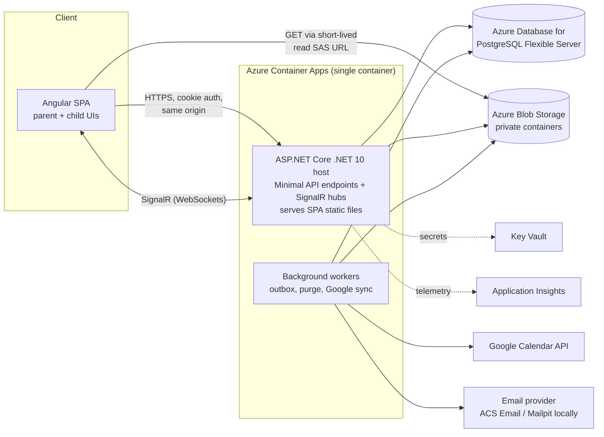
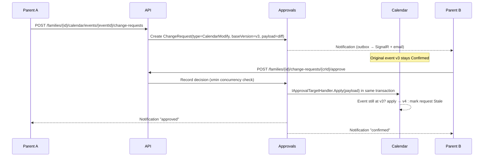

# Solution Architecture — Co-Parenting Family Platform

> Status: **Approved** (2026-10-16).
> Product name: **Parenthesis**. Code namespaces and projects use `CoParent.*`.

## 1. Architectural drivers

| Driver | Consequence for the design |
|---|---|
| Strict tenant isolation (family = tenant) | `FamilyId` on every family-owned row; membership check on every request; EF global query filters; cross-tenant integration tests. |
| Equal parental authority | No "owner" role. Sensitive changes go through a **ChangeRequest** that needs the other parent(s) to approve. |
| Mutual approval for agreements & deletions | One generic approval engine (PR-style) reused by Calendar, Memories and child-access changes. |
| Protective actions can't be blocked | A separate, immediate, audited **Restrict** path that hides content without deleting it (see ADR-0005). |
| Child privacy | Child diary is private by default; explicit, per-entry sharing; EXIF/GPS stripped from uploads; short-lived SAS URLs. |
| Admins can't read family content | Platform admin is not a family member, so tenant filters exclude all content by construction. |
| Small team, portfolio scope | Modular monolith, one deployable, one database. No microservices, no message broker. |

## 2. High-level view



**Why one container serving both API and SPA:** same origin means HttpOnly, `SameSite=Strict` cookies work without CORS, and hosting stays cheap. The SPA can be split out to Static Web Apps + Front Door later without code changes.

## 3. Modular monolith

Each module is **one .NET project** with internal folders (`Domain`, `Application`, `Infrastructure`, `Endpoints`). Everything is `internal` except a `Contracts` namespace that other modules may use. Architecture tests (`tests/CoParent.ArchitectureTests`, plain reflection) enforce this.

| Module | Owns | DB schema |
|---|---|---|
| **Identity** | ASP.NET Core Identity users, login, lockout, email confirmation, child logins | `identity` |
| **Families** | Family, FamilyMembership, Invitation, ChildProfile, ParentChildRelationship, category approval policy | `families` |
| **Approvals** | ChangeRequest, ApprovalDecision, the PR-style workflow engine | `approvals` |
| **Calendar** | CalendarEvent, attendees (children), reminders | `calendar` |
| **Memories** | Memory, MemoryAttachment, MemoryShare, soft delete & purge | `memories` |
| **Messaging** (post-MVP) | Conversation, Message, MessageAttachment | `messaging` |
| **Notifications** | Notification inbox, SignalR push, email digests | `notifications` |
| **Integrations** (post-MVP) | ExternalCalendarConnection, ExternalEventLink, Google sync | `integrations` |

Cross-cutting building blocks (`CoParent.SharedKernel`, `CoParent.Infrastructure`): base entity types, `ITenantContext`, `TimeProvider`, domain events, transactional outbox, audit interceptor, blob storage abstraction, EXIF stripping.

### Persistence: one database, one DbContext per module

- Each module has its own `DbContext`, schema and migrations history table. Modules never query another module's tables.
- All contexts share **one scoped `NpgsqlConnection`** per request, so a unit of work can span modules inside one transaction. This matters for approvals: when the final approval comes in, the ChangeRequest status and the calendar change it applies are committed **atomically**.
- Optimistic concurrency uses PostgreSQL `xmin`, so two parents clicking "approve" at the same moment can't apply a change twice.
- IDs are UUID v7 (`Guid.CreateVersion7()`): they sort by time and don't leak counts.

### How modules talk to each other

1. **Synchronous contracts** for queries and for in-transaction steps, e.g. `IFamilyMembershipReader`, `IApprovalTargetHandler`.
2. **Domain events → transactional outbox** for side effects that can be eventually consistent: notifications, emails, Google sync, audit fan-out. A `BackgroundService` drains the outbox. No broker is needed at this scale; Azure Service Bus can replace the dispatcher later.

## 4. Approval engine (the PR model)



Rules:
- The proposer's approval is implied. A request needs an **Approve** from every other *active* parent. One **Reject** resolves it as Rejected.
- Statuses: `Pending → Approved | Rejected | Withdrawn | Expired | Stale`.
- **Stale** works like a merge conflict: if the target changed after the request was created (`baseVersion` mismatch), the request can't be applied and has to be re-proposed.
- Handlers implement `IApprovalTargetHandler` for each `ChangeRequestType`: `CalendarCreate`, `CalendarModify`, `CalendarCancel`, `MemoryDelete`, `ChildAccessGrant`.
- Whether a calendar category needs approval is set per family in `CategoryApprovalPolicy`. Defaults: Parenting time and Holidays need approval; Medical, Dental, School, Activity and Birthday don't.
- Every create and every decision writes an `AuditLog` row.

**Calendar status mapping.** The spec's enum mixes two lifecycles: the event's and the request's. I split them:
- `CalendarEvent.Status`: `PendingApproval | Confirmed | Rejected | Cancelled`.
- `ChangeRequest.Status`: as listed above.
- The UI combines them. For example, it shows *"Confirmed · change pending"* when a confirmed event has an open modify request. The spec's `Proposed` state becomes a client-side draft. (Approved, see §9.)

## 5. Security model

### Authentication
- ASP.NET Core Identity with **cookie authentication**: HttpOnly, Secure, `SameSite=Strict`, plus antiforgery tokens on unsafe methods. No tokens are stored in `localStorage` (ADR-0004).
- Email confirmation, lockout, and password rules following NIST 800-63B (length over complexity, breached-password check later). TOTP 2FA is on the backlog.
- **Child logins** need no email. A parent generates a one-time code on the child's device, and the child picks a username and a password or passphrase. A child account is an Identity user with `UserType=Child`.

### Authorization (three layers, all server-side)
1. **Tenant gate.** An endpoint filter on every `/api/families/{familyId}/…` route resolves the caller's active membership and fills `ITenantContext`. If the caller isn't a member, the API returns **404**, not 403, so it doesn't leak whether the family exists.
2. **Role policies.** `ParentOnly`, `ChildOrParent`, `PlatformAdmin`.
3. **Resource-based handlers.** `IAuthorizationHandler` for each resource, e.g. `CanDecideChangeRequest` (a parent who isn't the proposer and hasn't decided yet) and `CanViewMemory` (applies diary sharing and Restricted state).

### Defence in depth for tenant isolation
- EF global query filter `e.FamilyId == tenant.FamilyId` on every family-scoped entity.
- A `SaveChanges` interceptor rejects any insert or update whose `FamilyId` doesn't match the current tenant.
- A cross-tenant integration test suite: for every endpoint, family B's member calls it with family A's IDs and must get 404.
- Later: PostgreSQL Row-Level Security keyed on `SET app.family_id` (ADR-0002).

### Media
- Private Blob containers only. The API returns **read SAS URLs valid for 5 minutes**, created with user-delegation keys (Managed Identity, no account keys).
- MVP uploads go **through the API** so it can validate the content type by magic bytes, enforce size limits, strip EXIF/GPS (ImageSharp) and create thumbnails. Direct-to-blob upload is an optimization for later.
- Blob paths: `families/{familyId}/memories/{memoryId}/{attachmentId}`.

### Data protection
- TLS everywhere. Azure Storage and PostgreSQL encrypt at rest by default.
- **Diary text** and **Google refresh tokens** get application-level encryption too (ASP.NET Core Data Protection, key ring in Blob and protected by Key Vault).
- Store as little child PII as possible: display name or nickname, and an optional birth month/year instead of a full birth date.

### Platform administrator
- A separate role with no `FamilyMembership`, so tenant filters return no family content. Admin endpoints under `/api/admin` show only aggregates and metadata (family count, storage, health).
- Legal or safeguarding removals follow a documented break-glass procedure: audited, with a reason code. Two-person approval comes post-MVP.

## 6. Frontend architecture (Angular)

- A current Angular major with standalone components, **signals**, the new control flow and lazy-loaded feature routes.
- State: services that expose signals, plus `@ngrx/signals` (SignalStore) for the busier features (calendar, approvals). No global NgRx Store; it's overkill here.
- UI: **Angular Material + CDK** with a custom, warm theme. Accessible primitives keep WCAG 2.2 AA achievable. A separate, simplified **Kid** layout and theme (bigger targets, icon-led navigation).
- HTTP: an OpenAPI-generated typed client, an interceptor for antiforgery and `ProblemDetails` → user-friendly errors, and a `familyId` context service.
- Real-time: one `@microsoft/signalr` connection per session that feeds the notification and approval signals.

```
src/frontend/src/app/
├─ core/          auth, http interceptors, api client (generated), signalr, guards
├─ shared/        ui components (avatar, status-chip, approval-card, media-tile, empty-state), pipes
├─ layout/        parent-shell, kid-shell
└─ features/
   ├─ auth/       login, register, accept-invite, child-activation
   ├─ dashboard/
   ├─ calendar/
   ├─ approvals/
   ├─ children/
   ├─ memories/
   ├─ messages/   (post-MVP)
   ├─ settings/
   └─ kid/        my-artwork, my-diary, my-photos, my-memories
```

## 7. API conventions

- REST, resource-oriented, everything under `/api/families/{familyId}/…`. `/api/me` covers the current user and their families.
- Approval actions are explicit sub-resources: `POST …/change-requests/{id}/approve | reject | withdraw`.
- Errors use RFC 9457 `ProblemDetails`. Validation uses FluentValidation and returns 400 with field errors.
- The OpenAPI document comes from `Microsoft.AspNetCore.OpenApi`, with Swagger UI in Development. The same document generates the Angular client.
- Cursor pagination for lists that grow without bound (memories, messages, audit).
- Rate limiting (`Microsoft.AspNetCore.RateLimiting`) on auth, invitations and uploads.

## 8. Repository structure

```
coparent/
├─ .github/
│  ├─ workflows/ci.yml            build, lint, unit + integration tests, docker build
│  ├─ workflows/deploy.yml        (later) bicep what-if/deploy, push image, migrate
│  └─ dependabot.yml
├─ docs/
│  ├─ architecture/               this doc, ERD, diagrams
│  ├─ adr/                        architecture decision records
│  ├─ planning/                   backlog, milestone plans
│  └─ runbooks/                   setup, deployment, break-glass
├─ infra/                         Bicep modules (container app, postgres, storage, kv, insights)
├─ docker/
│  └─ api.Dockerfile              multi-stage: node build SPA → dotnet publish → chiseled runtime
├─ src/
│  ├─ backend/
│  │  ├─ (solution + Directory.*.props live at the repo root)
│  │  ├─ CoParent.Api/            host: Program.cs, auth, middleware, OpenAPI, hub mapping, SPA hosting
│  │  ├─ CoParent.SharedKernel/   Entity, IFamilyScoped, Result, DomainEvent (time via .NET TimeProvider)
│  │  ├─ CoParent.Infrastructure/ connection/UoW, outbox, audit interceptor, blob, email, data protection
│  │  └─ Modules/
│  │     ├─ CoParent.Modules.Identity/
│  │     ├─ CoParent.Modules.Families/
│  │     ├─ CoParent.Modules.Approvals/
│  │     ├─ CoParent.Modules.Calendar/
│  │     ├─ CoParent.Modules.Memories/
│  │     ├─ CoParent.Modules.Notifications/
│  │     ├─ CoParent.Modules.Messaging/       (post-MVP)
│  │     └─ CoParent.Modules.Integrations/    (post-MVP)
│  └─ frontend/                   Angular workspace (see §6)
├─ tests/
│  ├─ CoParent.UnitTests/         domain + application logic, per-module folders
│  ├─ CoParent.IntegrationTests/  WebApplicationFactory + Testcontainers (PostgreSQL, Azurite)
│  ├─ CoParent.ArchitectureTests/ module boundary + tenant-filter coverage rules
│  └─ e2e/                        Playwright (post-MVP-1)
├─ tools/seed/                    synthetic demo data generator (no real data, ever)
├─ compose.yaml  .env.example   local infra: postgres, azurite, mailpit
├─ CoParent.slnx  global.json  Directory.Build.props  Directory.Packages.props
├─ .editorconfig  .gitignore  .gitattributes
├─ README.md  CONTRIBUTING.md  SECURITY.md  LICENSE
```

Inside each module:
```
CoParent.Modules.Calendar/
├─ Contracts/        public: DTOs + interfaces other modules may use
├─ Domain/           CalendarEvent aggregate, value objects, domain events
├─ Application/      command/query handlers (plain classes, no MediatR), validators
├─ Infrastructure/   CalendarDbContext, EF configurations, migrations
├─ Endpoints/        Minimal API route groups
└─ CalendarModule.cs AddCalendarModule(services) / MapCalendarEndpoints(app)
```

**No MediatR.** Handlers are plain injected classes, which keeps the code explicit and avoids the licensing change in recent MediatR versions. Cross-cutting concerns (validation, transactions) go into endpoint filters.

## 9. Decisions (all approved 2026-10-16, as recommended)

1. **Unified approval engine.** The spec's `CalendarProposal`/`CalendarApproval` and `DeletionRequest`/`DeletionApproval` become one `ChangeRequest` + `ApprovalDecision` model (ADR-0003). The `DeletionRequest` interface in the spec stays available as a projection.
2. **Split event status from request status** (§4). `Proposed` becomes a client-side draft.
3. **Cookie auth with the SPA served same-origin**, not JWT bearer tokens (ADR-0004).
4. **One DbContext per module on a shared connection** (§3), not one global DbContext.
5. **Frontend test runner.** Use **Vitest** (the default in current Angular CLI; Karma is deprecated) rather than Jasmine/Karma or Jest.
6. **Hosting.** Azure Container Apps (scales to zero, cheap) over App Service.
7. **Single-parent families.** Until the co-parent accepts the invitation, approval-required actions are **auto-confirmed and labelled "Confirmed before co-parent joined"**. The new parent sees them in a review list when they join. Alternative: block them until a second parent joins.
8. **Child login.** Enabling it needs the other parent's approval (`ChildAccessGrant`). Disabling it is immediate, protective and audited.
9. **Diary sharing.** Private by default. A child can share an entry with *both parents* or *nobody*. Sharing with only one parent is deliberately left out for MVP so the app doesn't become a source of conflict between parents.
