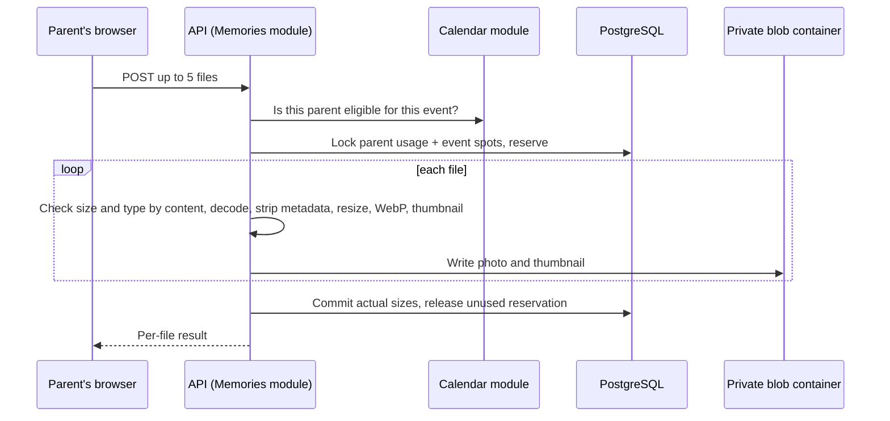
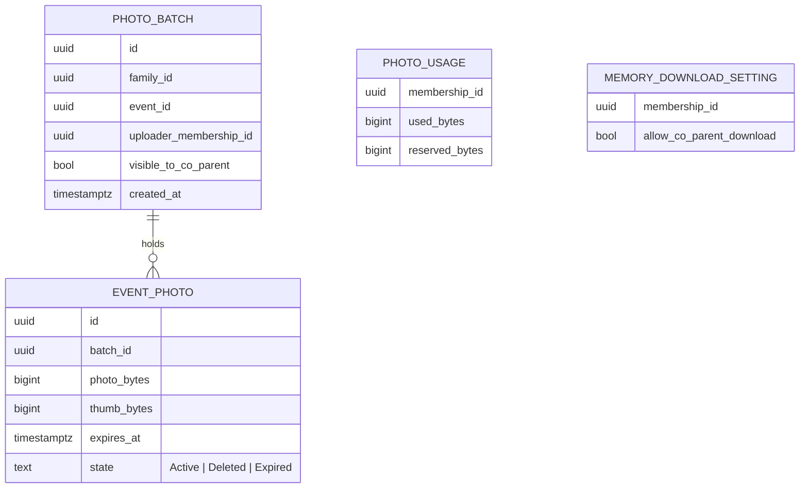

# Event photos and Family Memories (#403)

Status: **design approved by the owner on October 31, 2026 (in the Claude app); not implemented yet.** Product rules below were approved by the owner on October
31, 2026 (issue #403 body and the
[decisions comment](https://github.com/esaldivar/parenthesis/issues/403#issuecomment-6544684559)). Visual boards:
[`docs/design/reviews/issue-403/`](../reviews/issue-403/README.md). Nothing is implemented yet; the Family Memories
page stays the honest "coming soon" placeholder until the implementation PRs land.

Scope is parents only, in M3. Children don't upload or see event photos until #179 (M5). Google Photos export is #404
and isn't part of this work; the download permission below is written so #404 can reuse it.

## Rules

### Which events take photos, and who uploads

| Event | Uploaders | Photo spots |
|---|---|---|
| Parenting time, confirmed | The designated caregiver only | 20 for that parent |
| Joint, Holiday, School, Medical, Dental, Activity, Birthday, Other, confirmed | Both parents | 10 reserved for each; no borrowing |
| Pending, declined, cancelled (before any upload), Unavailable | Nobody | — |

- "Confirmed · change pending" counts as confirmed.
- Uploads are open from the event's start until 28 days after it ends.
- At most 5 photos per upload, 20 MB per source file.
- **Eligibility changes** (caregiver swapped, event cancelled after uploads): existing photos stay, keep their spots
  and their 28-day expiry. New uploads follow the new rule. A parent above their new cap can't add more until under
  it. A cancelled event's photos stay in Family Memories until they expire. Nothing is deleted silently.
- The server enforces every rule; the app only explains them.

### Privacy, sharing and downloads

| Action | Uploader | Co-parent | Child / other family |
|---|---|---|---|
| See a private batch (default) | Yes | No, not even a count | No |
| See a shared batch | Yes | Yes, while shared | No |
| Change **Visible to Co-Parent** | Yes, per batch | No | No |
| Download a photo or include it in a ZIP | Yes, until it expires | Only if shared **and** the uploader's **Allow co-parent to download my shared memories** is ON | No |
| Delete a photo early | Yes; frees its spot and storage at once | No | No |

- **Visible to Co-Parent** is OFF for every new batch. Sharing one parent's batch never changes the other's.
- **Allow co-parent to download my shared memories** is a personal Settings switch, OFF by default, covering all of
  that parent's photos including ones already shared. It never changes viewing.
- Turning either switch off stops new access within 5 minutes (see Serving). Copies already downloaded can't be
  recalled, and the app says so.

### Storage and expiry

- **250 MB per parent** (250,000,000 bytes), counted from the actual stored size of each photo and its thumbnail.
  Settings shows "38 MB of 250 MB used". An upload that doesn't fit is refused; nothing existing is deleted or
  shortened.
- Stored photos: WebP, long side at most 2560 px (never enlarged), at most 5 MB, all metadata removed (location
  included). Thumbnails: 480 px WebP.
- Every photo is deleted **28 days after upload** (UTC, shown in the family's time zone). From day 21 the event and
  Family Memories show a stronger warning next to **Download**. The event itself stays.
- TODO (owner): reconsider 14-day retention later. Existing photos keep the period they were uploaded with.

### iPhone photos (HEIC/HEIF) and RAW

No HEIC decoding on the server in M3 (SkiaSharp can't decode HEIC on Linux, and adding libheif brings HEVC patent and
native-library risk). The photo picker accepts `image/jpeg,image/png,image/webp` only; iPhone Safari converts HEIC
photos to JPEG when the picker asks for those types. The server checks file contents and refuses HEIC/HEIF and
DNG/ProRAW with an actionable message ("Export it as a JPEG and add that instead"). Uploads stay behind a feature flag
on production until a physical iPhone check confirms the conversion (physical device checks are deferred to #112 and
aren't M3 merge gates).

## Screens

Boards are in [`reviews/issue-403`](../reviews/issue-403/README.md), at 390px, 320px and 1280px in both themes.

| Board | Screen |
|---|---|
| E1 | Event details panel: Photos section with your private batch, the co-parent's shared batch, spots left, expiry |
| E2 | Empty, pending event (no photos until confirmed), other parent's parenting time, your spots full |
| U1 | Add photos sheet before upload: per-file checks (DNG, over 20 MB), retention and privacy note, limits |
| U2 | Uploading with per-file results, retry, storage full, event spots full, offline |
| S1 | Turning **Visible to Co-Parent** off; viewing and deleting one of your photos |
| X1 | Final-week warning with Download; photos already deleted |
| G1 | Family Memories page: one memory per event, newest first, expiry chips |
| G2 | Family Memories empty, loading and error |
| G3 | One memory: grid, **Download photos** with eligible count and size, omitted-photo explanation, none eligible, interrupted download |
| P1 | Settings → Memories: storage meter and the download permission switch with its help text |
| D1 | Home dashboard Family Memories card |

Implementation reuses Angular Material and the existing components (the event details panel, `app-empty-state`,
`app-icon`, toasts and the photo editor's file checks). The "Visible to Co-Parent" control is a Material slide toggle
with the batch named in its accessible label ("Visible to Co-Parent, your Oct 12 photos"). Upload results are
announced in a polite live region; errors use `role="alert"`. Buttons are at least 44 px. Photo grids keep a
readable order for screen readers ("Photo 2 of 7, shared by Mom").

## How it works

- **Module:** a new `CoParent.Modules.Memories`. The Calendar module exposes a small eligibility contract, so
  Memories never reads Calendar tables (the architecture tests enforce module boundaries).
- **Storage:** private Azure Blob container `event-photos`, path
  `families/{familyId}/memories/{eventId}/{photoId}/{photo|thumb}`; Azurite locally and in CI.
- **Serving:** through the API only, rechecking family, role, batch visibility, download permission and expiry on
  every request, with `Cache-Control: private, no-cache` and an ETag, so the browser revalidates each time (a 304
  sends no bytes) and revocation applies to the next request. Downloads use `no-store` and an attachment filename.
  No SAS URLs in M3.
- **Concurrency:** one transaction takes a per-parent PostgreSQL advisory lock, counts that parent's spots on the
  event and bytes in use, and reserves a row before the upload is processed, so parallel uploads can't both take the
  last spot or the last bytes (each parent's spots are their own, so a per-parent lock covers both). Failed uploads delete written blobs and release
  their reservation; a sweep clears reservations older than 15 minutes.
- **Expiry and cleanup:** every read path checks `expires_at`. An hourly worker deletes expired photo and thumbnail
  blobs, frees spots and reconciles usage. An Azure lifecycle rule scoped to `event-photos` only is a backstop; Azure
  deletes asynchronously, so the app never promises an exact deletion time. Soft-delete and backup retention are
  documented in the Azure runbook.
- **ZIP download:** streamed by the API, nothing stored. Each photo's access, expiry and download permission is
  checked right before it's written, so a photo that becomes ineligible mid-download is left out. Before starting,
  the app shows the count, approximate size and any omitted-photo explanation; the browser shows progress and can
  cancel. Filenames are safe and unique (`2026-10-12 Soccer final 01.webp`).
- **Telemetry:** no photo contents, filenames or private URLs in logs or telemetry.

## Delivery

1. This design PR (owner design approval).
2. Backend: module, migrations, storage, endpoints, quota, expiry worker, feature flag.
3. Frontend: event Photos section, upload, sharing, Family Memories, Settings, dashboard card.
4. ZIP download.

Owner step before uploads are switched on in development: create the private `event-photos` container in the dev
storage account and grant the Container App's managed identity **Storage Blob Data Contributor** on it (commands
in the Azure runbook, "Event photos (#403)").
