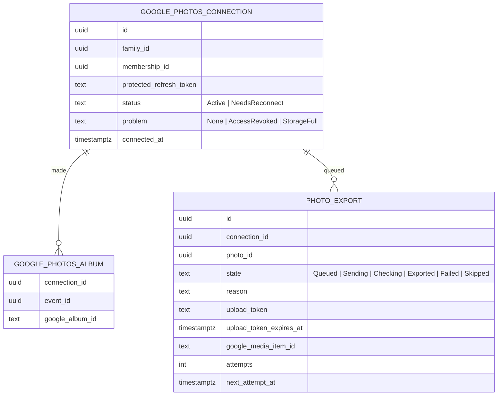

# Google Photos export (#404)

Status: **design approved by the owner on November 4, 2026 (in the Claude app), including both open questions as
proposed. Nothing here is built yet.** Product rules come from the
#404 issue body (owner decisions of October 31, 2026) and the #403 rules it reuses. The owner chose on November 4,
2026, in the Claude app: **one Google Photos album per event**, and **export a whole memory or a single photo**.
Visual boards: [`docs/design/reviews/issue-404/`](../reviews/issue-404/README.md). Google Cloud setup and the
verification tracker: [the runbook](../../runbooks/google-photos-export.md).

Scope is parents only, in M3. One way, Parenthesis → Google Photos. No import, no browsing the parent's library, no
sync back, no iCloud, no video. Children never see export controls (#179 stays M5).

## Rules

### Who can export what

Export follows the #403 download rule exactly. If a parent may download a photo, they may export it; if not, they
can't.

| Photo | Uploader | Co-parent | Child / other family |
|---|---|---|---|
| Your own photo, private or shared, not expired | Yes | No (private) or see next row | No |
| Co-parent's shared photo | — | Only if **Allow co-parent to download my shared memories** is ON | No |
| Co-parent's private photo | — | No, and it isn't counted or mentioned | No |
| Expired or deleted photo | No | No | No |

- The server rechecks family membership, batch visibility, the uploader's download setting and expiry **when the
  export is queued, before the bytes are sent to Google, and again before the item is added to the album**. If a
  check fails at any point, that photo is skipped and marked "Not exported" with the reason. Nothing already in
  Google is touched.
- Each parent connects **their own** Google account. Connecting, exporting or disconnecting never changes anything for
  the other parent.

### Connecting

- **Settings → Google Photos**, next to Google Calendar. Optional for parents; the export feature itself is required
  for M3.
- Scope: **`photoslibrary.appendonly` only.** Google describes it as write access that "only allows new media to be
  created in the user's library and in albums created by the app". Parenthesis can't see, list or change anything
  else in the parent's Google Photos, including the albums it made. No sign-in scopes, so Parenthesis doesn't learn
  which Google account was used.
- **Separate OAuth client from Google Calendar**, in the same Google Cloud project. Disconnecting Google Photos
  revokes its token; with a separate client that revocation can't reach the Calendar grant, and the reverse.
  Verification (brand, domain, consent screen) is per project, so it's shared; the Photos scope still needs its own
  data-access review (Calendar approval doesn't cover it).
- Same pattern as Calendar (#386): authorization code with PKCE, encrypted 10-minute `state` tied to the parent and
  family, redirect to `{App:PublicBaseUrl}/settings/google-photos`, finished through the API with the same-origin
  cookie and antiforgery. If the parent started from a memory, they return to that memory (an allow-listed in-app
  path carried inside the encrypted state, never an open redirect).
- Before Google's consent screen, Parenthesis says what's sent: only the photos the parent chooses, as the same
  version stored in Parenthesis (WebP, up to 2560 px, metadata removed). Copies count toward the parent's Google
  storage. Google's policy requires this disclosure before consent.
- Feature off until `GooglePhotos:ClientId` and `ClientSecret` are set; Settings and the export button then say
  "Exporting to Google Photos isn't available yet." On production it stays off until Google's review is approved.

### Exporting

- **A whole memory:** "Export to Google Photos" sits next to "Download photos" on a Family Memory. Before starting,
  a sheet shows how many photos will be exported, any omitted ones (without revealing private photos), the album
  name, and that copies can't be recalled.
- **A single photo:** "Export to Google Photos" in the photo viewer, next to Download.
- **Album per event, per parent:** Parenthesis creates one album in the parent's Google Photos per event, titled
  `{event title} · {event date}` (for example "Soccer final · Oct 12, 2026"), the first time that parent exports from
  that event. Later exports from the same event go to the same album. The title is the event title the parent sees
  in Parenthesis, the same text the Calendar copy already sends.
- **Already exported:** a photo this connection has exported shows "In your Google Photos" and is skipped by a later
  whole-memory export. Parenthesis can't see whether the parent later deleted it in Google, so there's no
  re-export in M3 (download is the fallback; owner decision below).
- **Exported copies are the parent's.** Turning off Visible to Co-Parent or the download setting later, deleting the
  photo in Parenthesis, or the 28-day expiry never removes a Google copy. The app says so before the first export.
- **Expiry still applies in Parenthesis.** An export doesn't extend the 28 days, and an attempted or queued export is
  never shown as a backup. The final-week warning keeps both Download and Export beside it. A photo that expires
  while waiting in the queue is marked "Expired before export".
- **Storage note:** every export reminds the parent that copies use their Google storage. Google asks apps to remind
  users once uploads pass 25 MB; Parenthesis shows it every time, which covers that.

### Status a parent sees

| Photo state | Shown as | Meaning |
|---|---|---|
| Queued, Sending | "Waiting to export", "Exporting…" | Not in Google yet |
| Exported | "In your Google Photos" | Google confirmed the item was created in the album |
| Checking | "Checking with Google…" | A request timed out and the result is unknown; retried safely (below) |
| Not exported | "Couldn't export: {reason}" + Try again where retrying can help | Failed; never labeled exported |
| Skipped | "Not exported: {reason}" | Access, download permission or expiry changed before sending |

Reasons are plain: "Google Photos needs you to reconnect", "Your Google storage is full", "Google is limiting exports
right now; Parenthesis will keep trying until Nov 9", "Mom turned off downloads of her photos", "This photo was
deleted", "This photo expired before it was exported", "Google Photos had a problem; try again". Status changes are
announced in a polite live region; failures that need action use `role="alert"`.

### Disconnecting and leaving

- **Disconnect** revokes the token, cancels anything still queued (marked "Not exported: disconnected") and forgets
  this connection's albums and "In your Google Photos" marks. Parenthesis can't see the Google library, so after
  reconnecting (perhaps to a different account) photos show as not exported, and new exports make new albums. The
  albums and photos already in Google stay; the app says so.
- If Google rejects the refresh token (the parent removed access in their Google account), exports pause and
  Settings and the memory page ask the parent to reconnect. Queued photos wait until they expire.
- Leaving the family or deleting the Parenthesis account deletes the connection, token and export records, as for
  Calendar.

## Screens

Boards are in [`reviews/issue-404`](../reviews/issue-404/README.md), at 390px, 320px and 1280px in both themes. They
extend the approved #403 boards and reuse their tokens and components.

| Board | Screen |
|---|---|
| C1 | Settings → Google Photos: not available yet, not connected (with what's shared before consent), connected, needs reconnect |
| C2 | Disconnect confirmation |
| M1 | One memory with **Export to Google Photos** beside **Download photos**, per-photo export marks |
| M2 | Export sheet: count, omitted photos, album name, storage and "can't be recalled" notes |
| M3 | Export sheet when not connected: connect first, then return to this memory |
| P1 | Photo viewer: Export to Google Photos, then "In your Google Photos" |
| S1 | Progress and per-photo results: exporting, in Google, couldn't export with Try again, skipped |
| S2 | Account-level problems: reconnect needed, Google storage full, Google limit (retrying), nothing eligible |
| X1 | Final week: export and download beside the warning; expired before export |

Implementation reuses the #403 components (memory page, photo viewer, `app-empty-state`, toasts) and the Calendar
settings card pattern (`google-calendar-settings.ts`). Buttons are at least 44 px. The export sheet is a Material
dialog/bottom sheet with focus moved to its heading and returned to the Export button on close.

## How it works

```mermaid
sequenceDiagram
  participant P as Parent's browser
  participant A as API (Memories module)
  participant D as PostgreSQL
  participant W as Export worker
  participant B as Private blob container
  participant G as Google Photos Library API
  P->>A: POST export (memory or photo ids)
  A->>D: Check access + download permission + expiry; queue items (unique per connection + photo)
  A-->>P: Queued count and omitted-photo summary
  loop every 30 s, one parent at a time
    W->>D: Next queued items for this parent; recheck access
    W->>B: Read the stored WebP
    W->>G: POST /v1/uploads (raw bytes) → upload token
    W->>D: Recheck access; save upload token (valid 1 day)
    W->>G: albums.create if this event has no album yet
    W->>G: mediaItems:batchCreate (album id, up to 50)
    G-->>W: Per-item status
    W->>D: Mark each item Exported only on an OK item status
  end
  P->>A: GET export status (polled while the sheet or memory is open)
```



- **Module:** Memories (it owns the photos and the permission rules); tables in the `memories` schema. The OAuth and
  token-protection helpers from Calendar's Google code are moved to a small shared place rather than copied, if the
  module boundary tests allow; otherwise the pattern is repeated with its own data-protection purpose
  (`CoParent.Memories.GooglePhotos.RefreshToken.v1`).
- **Idempotency:** `PHOTO_EXPORT` is unique on (connection, photo), so double clicks and repeated requests don't queue
  twice. The worker handles one parent at a time and never calls `batchCreate` in parallel for one user (Google's
  guidance). Upload tokens are kept for their one-day life, so a retry after a failed `batchCreate` reuses the
  token instead of re-uploading.
- **Ambiguous results:** if `batchCreate` times out, the item becomes **Checking** and is retried. Google says the
  same bytes are treated as the same media item and return the same id, so a retry normally doesn't create a
  second copy. Parenthesis doesn't promise exactly-once: the design and the app never claim it.
- **Album gone:** with only `appendonly`, Parenthesis can't look albums up. If Google rejects the stored album id (the
  parent deleted that album), the worker makes a new album for that event and retries once.
- **Limits and errors:** 429 waits at least 30 s and backs off; 5xx backs off from 1 s; a full Google storage
  response pauses that parent's exports with the "storage full" reason until they try again. Google's project limit
  is 10,000 requests a day (each photo is one upload plus a share of one `batchCreate`), far above expected use;
  a daily guard in the worker stops before it and says "Google is limiting exports".
- **Revocation:** every step rechecks access, so a photo whose sharing or download permission is turned off before
  it's sent is skipped. Once Google has created the item, it's the parent's copy.
- **Telemetry and logs:** no tokens, photo bytes, album or media ids, event titles or Google error text; status codes
  and counts only.
- **Privacy notice and data inventory** are updated in the implementation PR (new recipient: Google Photos; new
  stored data: the Photos refresh token and export records).

## Owner decisions (November 4, 2026)

Both questions were decided as proposed, in the Claude app:

1. **No re-export in M3.** A photo already marked "In your Google Photos" isn't offered again; Download covers a
   parent who deleted it in Google.
2. **No read-back scope.** `photoslibrary.appendonly` only; the "album gone" and "Checking" handling above covers it.
   Revisit `photoslibrary.readonly.appcreateddata` only if testing shows duplicates.

## Delivery

1. This design PR (owner design approval) and the runbook, so the Google Cloud setup and review can start now.
2. Backend: connection, OAuth, token storage, export queue and worker, status endpoints, feature flag, tests with a
   fake Google client.
3. Frontend: Settings card, memory and photo export, status, errors.
4. End-to-end with test Google accounts in Testing mode; then production only after Google's approval.

Our readiness and Google's review are tracked separately in the runbook; neither is marked done without evidence.
