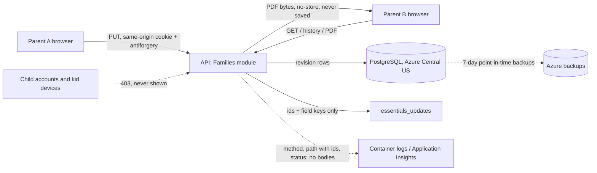

# Medication data preflight (#127)

**Status: owner decisions recorded November 12, 2026 (D1 to D11 below). A lawyer reviews this before medication
reaches production (D2); until then medication runs on Development with synthetic data only.**

November 12, 2026. A technical draft of the "Medication-data preflight" that
[#127](https://github.com/esaldivar/parenthesis/issues/127) requires before implementation. It is not legal advice:
the law sections list questions, not conclusions. Parenthesis must not be described as HIPAA-exempt or
HIPAA-compliant. Related: [data inventory](data-inventory.md), [compliance review](compliance-review-416.md),
[Child Essentials handoff](../design/child-essentials-handoff.md).

The owner recorded each decision in the [decision log](#decision-log) on November 12, 2026. The approved flow is in
the [data inventory](data-inventory.md) and the Privacy Notice, in the same PR as the implementation.

## What would be stored

Parent-entered reference only (#127). No dose calculations, recommendations, administration checklist, tracking of
whether doses were given, reminders or email.

| Field | Example (synthetic) | Notes |
|---|---|---|
| Medication name | "Sample allergy tablet" | Required. |
| Prescribed dose | "5 mL" | Optional free text; never parsed or calculated. |
| Schedule | "Before bed" | Optional free text. |
| Instructions | "With food" | Optional free text. |
| Status | Current or Discontinued | Discontinued entries move to history (handoff). |
| Updated by and when | Parent id, time | Shown as "who updated it and when"; "Former parent" after account deletion. |

Each child gets a list of entries. Following the existing Child Essentials pattern
(`child_allergies_food_revisions`, `child_medical_providers_revisions`), every save is a new revision row in the
`families` schema, scoped to the family by the tenant filter and cascaded from `child_profiles`.

## Proposed data flow

- **Who can read or write:** active parents of the family only (`tenant.Role == Parent`), like every other Child
  Essentials section. Children, kid tablets, caregivers and emergency contacts never see it. UI hiding is not the
  boundary; the API returns 403 to child sessions.
- **Third parties:** Microsoft Azure (hosting, database, backups, logs). No email (Brevo), Google, analytics or
  other services receive medication data.
- **PDF:** generated on request, `Cache-Control: no-store`, never written to the server. Filename
  `medications-YYYY-MM-DD.pdf`, with no child or medication name in it. Once downloaded, the copy on the parent's
  device is outside the app's control.
- **Update indicators (#128):** `essentials_updates` stores the child, section `medication`, revision and changed
  field keys (such as `dose`), never values. The banner says "{child}'s medication updated", not the medication name.
- **Logs, telemetry and audit:** request bodies, headers and SQL parameter values are already excluded (inventory).
  Validation problems must name the field, never echo the value. Audit records hold ids and the action only.

## Legal questions for the owner (and a lawyer)

The plan is United States-wide availability (#127). These are the rules #127 names, plus close relatives, with the
question each one raises. An engineering reading, not a determination.

| Rule | Why it may matter | Question to decide |
|---|---|---|
| [HIPAA](https://www.hhs.gov/hipaa/for-professionals/special-topics/developer-portal/index.html) | Applies to covered entities (providers, plans, clearinghouses) and their business associates. | Will Parenthesis ever offer this feature for, or receive data from, a provider or health plan? Planned answer: no. Record it; don't market any HIPAA status. |
| [FTC Health Breach Notification Rule](https://www.ftc.gov/business-guidance/resources/complying-ftcs-health-breach-notification-rule-0) (16 CFR 318) | Covers vendors of personal health records not covered by HIPAA. The 2024 update addresses health apps, and an unauthorized disclosure counts as a breach. | Is Child Essentials (allergies, medical providers, medication) a personal health record under the rule? If it might be, adopt its notice timelines in a breach runbook. |
| [Washington My Health My Data Act](https://app.leg.wa.gov/RCW/default.aspx?cite=19.373) (RCW 19.373) | Broad "consumer health data" definition, no revenue threshold, private right of action. Requires a separate consumer health data privacy policy, consent before collecting or sharing beyond what's needed, and access and deletion rights (including from backups). | Does it apply to a free U.S.-wide service run by an individual with Washington users? Who gives consent for a child's data: the entering parent, both parents? Is the co-parent a "third party" under the act, or a user of the same service? |
| [Nevada NRS 603A](https://www.leg.state.nv.us/NRS/NRS-603A.html) | Reasonable-security and breach-notice duties, plus the 2023 consumer health data provisions (similar to Washington, without a private right of action). | Same applicability and consent questions as Washington. |
| [COPPA](https://www.ftc.gov/business-guidance/resources/complying-coppa-frequently-asked-questions) | Covers personal information collected online from children under 13. | Medication is entered by parents and never shown to or collected from children. Confirm that keeps it outside COPPA's collection rules, and that the existing children's notice section covers it. |
| Other states (for example Connecticut's consumer health data rules, California's CMIA) | Some states regulate consumer health data or health-information software regardless of size. | Which other states' rules does the lawyer want checked before launch? |
| State breach-notification laws | Many define medical information as personal information. | Covered by the breach runbook decision (D9). |

## Decision log

The owner's decisions, November 12, 2026. A lawyer reviews the whole page before medication reaches production
(D2). Answers follow the existing Child Essentials and account-deletion behavior.

| # | Decision | Proposed answer | Owner decision |
|---|---|---|---|
| D1 | Operating model | Individual operator, U.S. only, consumer app for parents. No provider, health plan or employer relationship. | Approved as proposed. Owner, Nov 12, 2026 |
| D2 | Lawyer review timing | Before medication reaches production (the Washington private right of action raises the stakes). Development may use synthetic data before then. | Approved as proposed. Owner, Nov 12, 2026 |
| D3 | Who can authorize collection | Any active parent of the family, without mutual approval (#127, equal authority). | Approved as proposed. Owner, Nov 12, 2026 |
| D4 | Notice and consent | Add a health-data section to the Privacy Notice, and a separate consumer health data policy if Washington or Nevada applies. Before a family's first medication entry, the entering parent confirms once that it will be stored and visible to the co-parent; record the parent, time and notice version. | Approved as proposed. Owner, Nov 12, 2026 |
| D5 | Co-parent access | Both active parents see all entries, history and PDFs. The entering parent is told this before saving. | Approved as proposed. Owner, Nov 12, 2026 |
| D6 | Access revoked or family membership ends | A parent who leaves or deletes their account loses access at once (membership `Left`); their update notices are deleted. Entries they wrote stay with the family as "Former parent", like other Child Essentials. When the last parent leaves, the family and all medication data are deleted. | Approved as proposed. Owner, Nov 12, 2026 |
| D7 | Discontinue vs. delete | **Discontinue** moves an entry to history; either parent can do it. **Delete permanently** removes the entry and all its revisions, as a separate action with its own explanation. Choose: (a) either parent alone, confirmed, audited without content, other parent notified "A medication entry was deleted"; or (b) both parents approve, like memories (ADR-0003). Restrict (ADR-0005) doesn't apply: children never see this data. | Approved (a): either parent alone. Owner, Nov 12, 2026 |
| D8 | Retention | Current and discontinued entries and their history: until deleted (D7), the child's record is removed on request, or the family closes. Deleted data leaves database backups within 7 days (point-in-time retention); the notice says so. PDFs aren't stored. Container logs (30 days) hold no values. | Approved as proposed. Owner, Nov 12, 2026 |
| D9 | Breach response | Add a breach runbook with the FTC rule's and state notice timelines before production, covering all Child Essentials health data. See [breach-response.md](../runbooks/breach-response.md). | Approved as proposed. Owner, Nov 12, 2026 |
| D10 | Privacy requests | Access: the parent views history and downloads the PDF; copies by email within 30 days as today. Deletion: D7 and family closure. A Washington-style "list of third parties" names Azure only. | Approved as proposed. Owner, Nov 12, 2026 |
| D11 | Existing health-adjacent data | Allergies and medical providers are already stored (v0.4.0) and aren't in the data inventory. Apply D4 to D10 to them too, and add them to the inventory and notice before v0.4.0 reaches production. | Approved as proposed. Owner, Nov 12, 2026 |

## Verification before medication ships

These become acceptance tests in the implementation PR.

- [ ] A child session and a kid-tablet session get 403 on every medication endpoint and the PDF.
- [ ] Another family's parent gets 404 (tenant isolation); a parent who left gets no access.
- [ ] Saving a sentinel value (such as `SYNTHETIC-MED-7f3a`) leaves it out of `essentials_updates`, audit records,
      captured logs and validation problems.
- [ ] The PDF response is `no-store`, its filename has no names, and nothing is written to blob storage.
- [ ] No email is sent on any medication action.
- [ ] Data inventory, Privacy Notice (English and Spanish) and `stored-items` list updated in the same PR.
