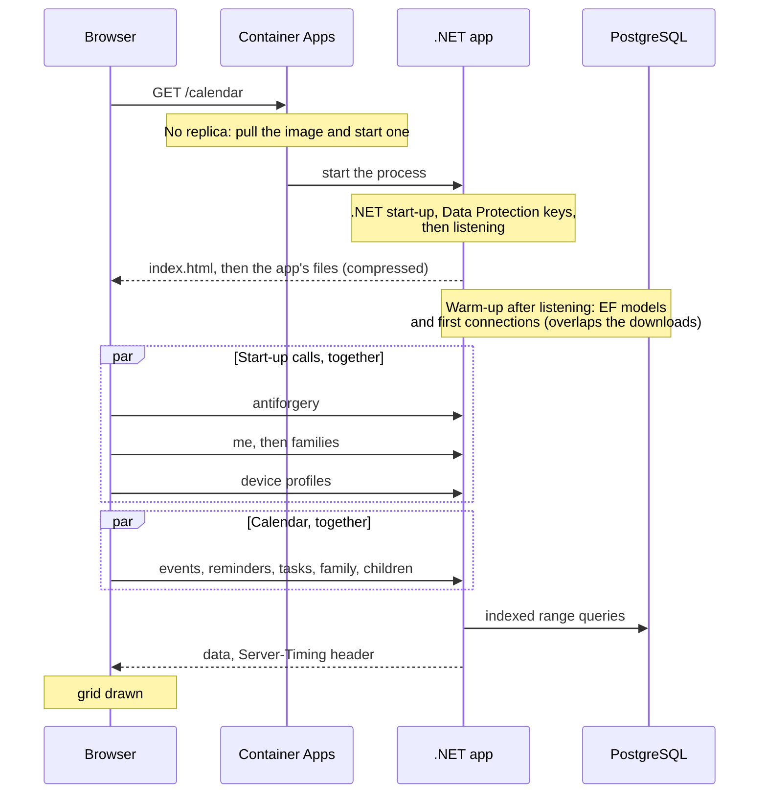

# Calendar first-load timing (#415)

The calendar sometimes loaded slowly when first opened. This page records what was measured, what changed, and how to
measure it again on a deployed site.

## What happens on a first open

The app runs on Azure Container Apps and scales to zero after a few idle minutes (owner decision, November 4, 2026: keep
it that way, no always-on replica). The first visit after a quiet spell has to start a replica before anything answers.

## Where the time went

The calendar's own queries were never the problem: once warm, all five calendar requests together take about 40 ms
locally and about 100 ms on half a CPU. Almost all of the delay was the cold start and the requests that queued behind it.

| Cause | Before | After |
|---|---|---|
| The image a new replica pulls | 867 MB (every platform's native libraries) | 290 MB (one platform) |
| .NET code at start-up | compiled on first use (JIT) | precompiled (ReadyToRun) |
| EF models and first DB connections | built inside the first requests | warmed in the background once listening |
| The app's files (main file 192 KB) | sent uncompressed | Brotli or gzip (main file about 53 KB) |
| Browser start-up calls | 3 one after another, then families | all at once; families as soon as the user is known |
| Moving between weeks | skeleton every time | a week seen in this tab shows at once while it reloads |

## Measurements (local, synthetic family)

Synthetic data only: one parent, one child, 28 events. Each run starts the app from nothing, then makes the browser's
start-up calls and the calendar's five requests the way the app does. Five runs each; medians. Measured November 4,
2026 in the development sandbox, so absolute numbers are lower than Azure's; the comparison is what matters.

**Container at Azure's default size (0.5 vCPU, 1 GiB),** both images built from `docker/api.Dockerfile`:

| Step (median ms) | Before | After |
|---|---|---|
| Container start to listening | 5,006 | 5,118 |
| Start-up calls (antiforgery, me, families) | 1,970 | 693 |
| First calendar load (five requests) | 2,006 | 1,285 |
| **Start to calendar data** | **8,929** | **7,145** |
| Warm calendar load | 94 | 101 |

This test sends its requests the moment the app listens, so the warm-up competes with them. In a browser the app's
files download first, which gives the warm-up time to finish. The smaller image doesn't show here (the image was already
on the machine); on Azure a cold start on a new node also pulls it.

**Published app on 4 CPUs (no container):** start to calendar data 4,124 ms before, 2,664 ms after. With only the
warm-up (no ReadyToRun): 3,603 ms.

**Rendering:** the browser marks `parenthesis:calendar-data` (load start to data) and `parenthesis:calendar-render`
(load start to grid drawn) on every calendar load. Unit tests can't time real rendering; measure it in a browser.

## Measuring a deployed site

Nothing here needs a sign-in or touches family data.

1. Leave the site idle for at least 10 minutes.
2. Run `scripts/measure-cold-start.sh https://dev.parenthesisfamily.com` (Git Bash, WSL, macOS or Linux). It prints
   the cold and warm health-check times, each response's `Server-Timing`, and the main file's size with and without
   compression.
3. For the calendar itself, open the browser's developer tools before opening the site, then open `/calendar`:
   - **Network:** each API response has `Server-Timing: app;dur=…` (time spent in the app). The first response a new
     replica serves also has `start;dur=…`: how long the process had been running, so roughly the cold start.
   - **Console:** `performance.getEntriesByName('parenthesis:calendar-data')[0].duration` and
     `performance.getEntriesByName('parenthesis:calendar-render')[0].duration` give the data and drawing times in
     milliseconds for the latest calendar load.
4. Compare under the same conditions: same network, same idle time, same week.

`Server-Timing` holds durations only: no identifiers, hostnames or personal data. Browsers show it only to the same site.

## Loading, retry and caching

- Loading shows the branded indicator (#413) with "Loading your calendar…". After four seconds it adds that Parenthesis
  may be starting up after a quiet spell. Screen readers hear each message once; reduced motion shows the still icon.
- A load that fails the way a starting app does (no connection, 502, 503 or 504) is retried once after 1.5 seconds.
  If that fails too, the existing error and **Try again** show. Other errors are never retried.
- Weeks and months seen in this tab are kept **in memory only** (owner decision, November 4, 2026), at most 12 periods
  for at most 10 minutes. A cached period shows at once with "Updating…" and is always replaced by the server's answer.
- The cache is keyed by viewer and family. It is emptied when the signed-in parent or child changes, on sign-out and
  account switch, and whenever the app sends any change to the server (an edit, a deletion, an approval, anything
  that isn't a read), both when the change is sent and when it finishes. A co-parent's change on another device shows
  as soon as the period's reload returns. Nothing is written to the device, so a reload or a new tab starts empty.
- API responses are never compressed, only the app's own files: a compressed response that mixes a secret with
  reflected input could leak it (BREACH).
