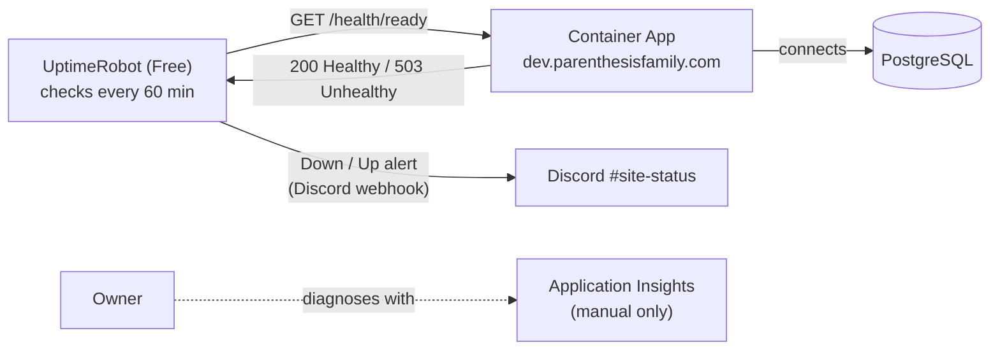

# Uptime monitoring (UptimeRobot → Discord #site-status)

Free external checks that post outage and recovery alerts in the Discord channel **#site-status** (#114).

**Cost rule: $0/month for monitoring and alerting.** Stay on UptimeRobot's Free plan. Don't start a trial, enter a
payment method, upgrade, or turn on paid Azure monitoring (alert rules, availability tests, Logic Apps, SMS) for this.
Application Insights is for manual diagnosis only.

## Free plan, as checked on October 28, 2026

Check these again before setup and once a year; plans change.

| Need | Free plan |
|---|---|
| Monitors | 50 ([pricing](https://uptimerobot.com/pricing/)) |
| Shortest interval | 5 minutes; longer intervals are allowed |
| Discord alerts | Included ([Discord integration](https://uptimerobot.com/integrations/discord-integration/)) |
| Commercial use | Allowed ([who the Free plan is for](https://help.uptimerobot.com/en/articles/11604710-who-should-use-uptimerobot-s-free-plan)) |
| "Alert only after N failures" (postponed notifications) | **Paid only** ([help](https://help.uptimerobot.com/en/articles/11361289-recurring-postponed-notifications-in-uptimerobot)) |

Free can't delay alerts, so a single failed check can alert. The 60-minute interval below already makes alerts rare.
If false alarms become a problem, the fix is a free alternative proposed to the owner, not an upgrade.

If Discord alerts or the needed features stop being free, stop and propose a verified free alternative to the owner.

## How it fits together

## What is monitored

| Monitor name | Type | URL | Interval | Status |
|---|---|---|---|---|
| `DEV · Parenthesis · ready` | HTTP(s) | `https://dev.parenthesisfamily.com/health/ready` | 60 minutes | To set up |
| `PROD · Parenthesis · ready` | HTTP(s) | production `APP_URL` + `/health/ready` | Decide then | When production has a public address |

- `/health/ready` returns `200 Healthy` when the app is up and can reach PostgreSQL, and `503 Unhealthy` otherwise.
  The body is only that one word: no hostnames, versions, exception text or personal data. Integration tests in
  `tests/CoParent.IntegrationTests/Api/HealthEndpointTests.cs` hold it to that.
- **Why 60 minutes, not 5.** The Container Apps scale to zero when idle, and they stay up for about five minutes after
  a request. A check every 5 minutes would keep a replica running all month, and that adds Azure compute charges
  (owner decision, October 28, 2026). The cost is detection: an outage can take up to an hour to show up. Each check may
  wake the app from cold, so set the monitor's request timeout to the longest the Free plan allows.
- **Production.** Before adding the PROD monitor, check its scaling settings. If production keeps a replica running
  anyway, a 5-minute check costs nothing extra. If it scales to zero, the same trade-off applies.

## Alert content and privacy

Alerts show the monitor name, URL, status (down/up), reason (such as `503` or timeout) and duration. Keep them that way:

- Monitor names say the environment and the app only: `DEV · …` or `PROD · …`. Never use family names, children's names,
  email addresses or anything from the database.
- Only monitor `/health/*` URLs. Never monitor a page that shows family data or needs a sign-in.
- **The Discord webhook URL is a secret.** Anyone with it can post in the channel. Never commit it, paste it in an
  issue, PR, chat or screenshot, or store it anywhere except UptimeRobot and the approved GitHub Actions secret.

## Setup (owner, once)

1. **Account.** Sign up at <https://uptimerobot.com> with the owner's own email, choose **Free**, and turn on two-factor
   authentication. Don't enter a payment method. The owner owns the account; add nobody else for now.
2. **Discord webhook.** In Discord, open **#site-status** → *Edit Channel* → *Integrations* → *Webhooks* →
   *New Webhook*. Name it `UptimeRobot`, then *Copy Webhook URL*. Paste it straight into the next step and nowhere else.
3. **Connect Discord.** In UptimeRobot: *Integrations & API* → *Chat platforms* → *Discord* → *Add* (not under
   *Connectors & Incident manag.*, where Zapier and PagerDuty are paid). Paste the webhook URL, label it
   `#site-status`, and select both **down** and **up** (recovery) events. Save.
4. **Add the DEV monitor.** *New monitor* → *HTTP(s)*, with the name, URL and interval from the table above. Set the
   request timeout to the longest allowed. Under notifications, select the `#site-status` Discord integration. Save.
5. **Test** as below, then tick the owner items for #114 in [TODO.md](../../TODO.md).

## Test an outage and recovery without touching users

The real monitor stays as it is. Use a throwaway monitor against a path that's always "down":

1. Add a monitor named `DEV · TEST · ignore`, *HTTP(s)*, URL `https://dev.parenthesisfamily.com/health/unknown`,
   interval 5 minutes, notifying `#site-status`. That path isn't a health check, so it never returns 200.
2. Within a few checks, **#site-status** gets a **down** alert. Confirm it names the monitor and shows no personal data.
3. Edit the monitor's URL to `https://dev.parenthesisfamily.com/health/live`. On the next check, the **up** (recovery)
   alert arrives.
4. Delete `DEV · TEST · ignore`, so it doesn't keep the app awake.

## Adjust, pause or turn off

- **Change the interval or timeout:** edit the monitor. Keep the cost note above in mind before going under 60 minutes.
- **Pause alerts** (for example during planned work): pause the monitor; resume it afterwards.
- **Stop Discord alerts:** remove the Discord integration from the monitor, or delete it under *Integrations & API* → *Chat platforms*.
- **The webhook URL leaked:** delete the webhook in Discord (that disables it at once), create a new one, and paste the
  new URL into the UptimeRobot integration.
- **Turn it all off:** delete the monitors and the Discord integration, then delete the webhook in Discord.

## When an alert fires

1. Open `https://dev.parenthesisfamily.com/health/live`. If it's `Healthy` but `/health/ready` isn't, the app is up and
   PostgreSQL is unreachable.
2. Check the Container App's revisions and logs, and Application Insights if it's wired up
   ([Azure environments](azure-environments.md)).
3. A recovery alert usually follows on its own after a deploy or a short Azure blip. If not, follow the Azure runbook.

## Daily Discord summary (#114)

The owner added repository secrets `UPTIMEROBOT_API_KEY` and `DISCORD_WEBHOOK_URL` on October 28, 2026.
Their presence and live delivery still need verification in Actions; no secret values belong in this runbook.

`.github/workflows/daily-health-report.yml` reads **monitor 804458679** for
`https://dev.parenthesisfamily.com/health/ready` using UptimeRobot's read-only
[v2 getMonitors API](https://uptimerobot.com/api/legacy/). It does not call the app, edit monitors, change the check
interval, or change the existing down/up Discord integration. A monitor-specific read-only API key is sufficient.

- Schedule: **8:00 AM America/Chicago**, using GitHub's native
  [timezone-aware schedule](https://docs.github.com/en/actions/reference/workflows-and-actions/workflow-syntax#onschedule).
  DST is automatic (13:00 UTC in summer, 14:00 UTC in winter). GitHub may delay or drop scheduled runs during load;
  this is a daily summary, not an exact-time delivery guarantee.
- Scheduled execution starts only when the workflow reaches the default branch, `main`. Follow the normal release
  route; merging into `release/0.3.0` or `develop` alone does not activate it.
- After promotion, open **Actions → Daily Discord health report → Run workflow**, select `main`, and run it once.
  Each manual run intentionally posts a fresh summary. Check that the run succeeds and the message arrives in the
  channel belonging to `DISCORD_WEBHOOK_URL`; separately confirm existing outage/recovery alerts still work.
- Content: current monitor status; returned trailing 1/7/30-day uptime ratios; mean of valid returned response-time
  samples from the trailing 24 hours, including sample count; and the configured interval when returned.
  Windows are rolling periods ending at retrieval, not the previous calendar day. Missing/invalid metrics are
  omitted, not replaced with zero. No incident counts, percentiles, database timings, CPU, memory or billing data
  are invented. Sparse monitor samples do not prove continuous health between checks.
- No paid service, extra application requests, or dependency installation is introduced. The workflow uses a short
  GitHub-hosted runner job; existing GitHub Actions billing/account limits still apply.
- API errors, a missing/mismatched monitor, missing secrets, or a failed Discord request fail the run. Errors exclude
  response bodies and secret URLs. Discord delivery uses `wait=true`; webhook POSTs are not automatically retried,
  because an ambiguous failure may already have delivered the message. Inspect the channel before rerunning.
- Disable only this summary in Actions → Daily Discord health report → Disable workflow. Outage alerts keep running.
  Keep webhook values only in approved secret storage. If the webhook was exposed, replace it in Discord and update
  the GitHub secret (and UptimeRobot too if it used that same webhook).

Local regression check: `node --test .github/scripts/daily-health-report.test.mjs` (no network or secrets).
CI runs the same tests on PRs. Live credentials and channel receipt cannot be certified by synthetic tests.
