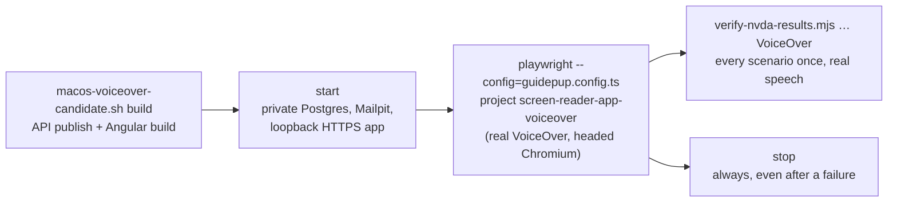

# Real VoiceOver on macOS — #443

Desktop macOS VoiceOver acceptance split from #281. Windows NVDA runs in CI ([NVDA website CI](nvda-website-ci.md));
VoiceOver runs on the owner's Mac, because a hosted macOS runner would spend this private repository's included
Actions minutes at the macOS rate. Physical iPhone VoiceOver is separate (#112).



## One-time Mac setup

Use an unlocked Mac session with nothing else running a screen reader or GUI test. Do it yourself, once; the tests
never change system settings.

1. Install the tools: Xcode command line tools, the .NET SDK in `global.json`, Node from `src/frontend/.nvmrc`,
   and `brew install postgresql@17 mailpit`.
2. From `tests/e2e`: `npm ci`, then `npx playwright install chromium`. On macOS 13 Playwright refuses to install its
   Chromium; use the installed Google Chrome instead with `export E2E_BROWSER_CHANNEL=chrome` (VoiceOver then
   activates Google Chrome rather than Chrome for Testing).
3. Run `npx @guidepup/setup@0.29.3` once. It enables "Allow VoiceOver to be controlled with AppleScript" and the
   VoiceOver defaults Guidepup needs. On recent macOS it may ask you to confirm in VoiceOver Utility or System
   Settings.
4. In **System Settings → Privacy & Security**, allow **Accessibility** and **Automation** (System Events, VoiceOver)
   for the app that runs the tests: Terminal, iTerm, or the Claude app for a Remote Control session.
5. Turn VoiceOver's Quick Nav off (it intercepts the arrow keys the date-picker journeys use).

## Run

From `tests/e2e`, on the exact commit under test:

```bash
scripts/macos-voiceover-candidate.sh build
scripts/macos-voiceover-candidate.sh start
export E2E_BASE_URL=https://localhost:8443 MAILPIT_URL=http://127.0.0.1:8025 E2E_TESTED_SHA=$(git rev-parse HEAD)
export PLAYWRIGHT_JSON_OUTPUT_NAME=guidepup-results/voiceover-results.json
npx playwright test --config=guidepup.config.ts --project=screen-reader-app-voiceover --workers=1 --reporter=list,html,json
node scripts/verify-nvda-results.mjs guidepup-results/voiceover-results.json VoiceOver
scripts/macos-voiceover-candidate.sh stop
```

Don't type, click or switch windows while it runs: VoiceOver speaks and the tests send real keystrokes. On macOS the
config lists only the VoiceOver project, so the NVDA projects never start there; on Windows nothing changes.
`scripts/macos-voiceover-candidate.sh status` shows what is still running; `stop` is safe to repeat.

Record with each run: macOS version and build, Chromium (`npx playwright --version` and the report), VoiceOver
(the macOS version), `@guidepup/guidepup` and `@guidepup/playwright` (`npm ls`), the tested SHA, the pass count, and
the `voiceover-app-speech` attachments from `guidepup-report`. `logs/candidate.json` in the candidate directory has
the SHA, macOS, Postgres, Mailpit, .NET and Node versions.

## Coverage

| Spec | Real VoiceOver behavior asserted | Tracking |
| --- | --- | --- |
| `smoke-voiceover` | Heading and named button speech on a synthetic page, without the app | host control |
| `navigation-voiceover` | Seven sidebar link names and destinations, "current page", Notifications and account menu, focus to main | #281 |
| `forms-voiceover` | Activity labels, required Title, Category, dates, child, optional fields; empty-title alert and focus; no POST | #281 |
| `calendar-voiceover` | Calendar and Add headings, validation, keyboard save, the polite success toast without focus theft, one saved event | #226 |
| `calendar-dialog-voiceover` | Named event dialog, both focus-trap edges, Keep it with its description, Escape and Close restore focus | #213, #172 |
| `dates-voiceover` (1) | Picker day speech; start after end refuses Send, focuses End, says invalid and the hidden reason; correction clears it | #248, #249 |
| `dates-voiceover` (2) | Typed-date format hint, past-date alert and focus, corrected date saves once with its toast | #236 |
| `reminder-details-voiceover` | Reminder dialog title and type, When/About facts by VoiceOver cursor, delete confirmation choices, Keep it and Escape focus | #173, #172 |
| `task-progress-voiceover` | Task state, checklist checkbox states, "1 of 2 done" progress, polite completion message, Done state saved | #281 map |

Assertions match meaningful words in VoiceOver's actual speech (order-insensitive where VoiceOver and NVDA differ),
plus Playwright checks of focus, URL, ARIA state and saved data. VoiceOver logs speech after each Guidepup command;
the journey also reads VoiceOver's current last phrase so a polite announcement that arrives later still counts.

## Controlled negative

Change one expected phrase (for example `/current page/i` in `navigation-voiceover`) to a phrase that can't be said,
run that spec alone and confirm it fails at the speech assertion with the actual captured speech in the attachment.
Restore it and rerun to pass. Never commit the deliberate failure.

## Limits

- Desktop VoiceOver with Chromium only (owner decision, November 13, 2026): Playwright's Chromium, or the installed
  Google Chrome where Playwright's build isn't available. Safari/WebKit VoiceOver and iPhone
  VoiceOver (#112) remain manual checks.
- Owner-machine evidence, not a CI gate. Promoting it to a required check needs a supported macOS runner and the
  owner's approval.
- Rows stay in the disposable candidate database until `stop`, which deletes the cluster.
